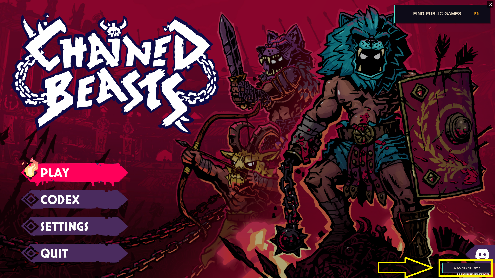
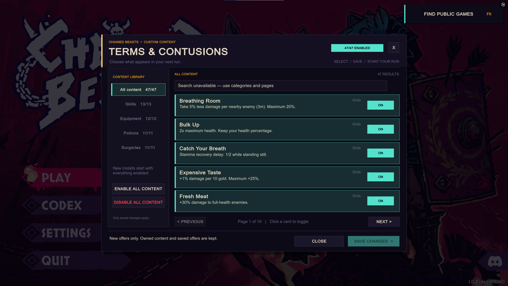

# Chained Beasts Mod Foundation + Terms & Contusions

I started messing around with modding **Chained Beasts** and ended up making two things:

- **Terms & Contusions** - my collection of 47 custom skills, equipment items, potion afflictions, and surgeries. Some are useful. Some are probably ridiculous.
- **Mod Foundation** - the code that makes those additions possible. It's also here for anyone else who wants to build their own mods.

You can just download Terms & Contusions and play, or dig into Foundation and make something yourself. **You don't need to know anything about coding to install the playable mod.**

**[Download Terms & Contusions + Foundation v1.0.0](https://github.com/Krrrrrrk/chained-beasts-mod-foundation/releases/download/v1.0.0/TermsAndContusions-with-Foundation-1.0.0.zip)**

Made for **Chained Beasts 1.0.2**, Steam build **26231777**, on **64-bit Windows**. If the game updates, check the [compatibility notes](docs/GAME_UPDATE_1.0.2.md) before assuming everything still works.

**Just want to play?** Head to [Quick install](#quick-install).

**Want to make your own stuff?** Skip to [Make your own mod](#make-your-own-mod).

A small warning before we go any further: **I haven't tried to balance this stuff.** A skill might be hilariously overpowered, underwhelming, or just plain broken. That's half the fun of experimenting, but don't say I didn't warn you.

## What's in Terms & Contusions?

The current pack has **47 additions**:

| Type | Count | Notes |
|---|---:|---|
| Skills | 13 | Twelve have four ranks; Iron Grip has just one |
| Equipment | 12 | Gives bonuses while equipped |
| Potion afflictions | 11 | Three severity levels each |
| Surgeries | 11 | Once per player per run |

You'll find them mixed in with the normal trainer, equipment shop, potion, and surgery offers. Custom descriptions start with **`TC:`** so you can tell them apart from vanilla content.

If you want to see exactly what each one does, check out the [complete content catalog](docs/terms-and-contusions/CATALOG.md) or the [content-pack guide](docs/terms-and-contusions/README.md).

Version **1.0.0** also adds a **TC Content** menu for turning individual entries on and off. All 47 are enabled by default. More on that [below](#choose-your-tc-content).

## Quick install

This is the **ready-to-play** setup. No Git, PowerShell, or .NET SDK needed.

Already running an older version? Read [how to update an existing install](docs/INSTALLATION.md#updating-an-existing-install) first, especially if you have a saved run.

### 1. Find the game folder and back up your saves

In Steam, right-click **Chained Beasts → Manage → Browse local files**. You should be in the folder with `ChainedBeasts.exe`.

Close the game before installing anything.

I'd also strongly recommend [backing up your saves](docs/INSTALLATION.md#back-up-your-install-and-saves). It's an experimental mod, and I'd rather you have a backup you don't need than need one you don't have.

### 2. Install BepInEx (if you haven't already)

BepInEx is what loads the mods into the game. If you've already got **BepInEx 6 IL2CPP x64** working, you can skip this step.

1. [Download the BepInEx build I've tested with](https://builds.bepinex.dev/projects/bepinex_be/791/BepInEx-Unity.IL2CPP-win-x64-6.0.0-be.791%2Bb782da4.zip) - version `6.0.0-be.791+b782da4`, Unity IL2CPP, Windows x64.
2. Extract **everything** from the ZIP into your game folder, right next to `ChainedBeasts.exe`. Don't accidentally put it all inside an extra folder with the ZIP's name.
3. Launch the game normally. The first BepInEx launch can take longer than usual. Once you get to the main menu, close it again.

Make sure you grab the **IL2CPP x64** download, not Mono or x86. If it isn't loading, the [installation troubleshooting guide](docs/INSTALLATION.md#troubleshooting) is a good place to start.

### 3. Install Terms & Contusions

**[Download the v1.0.0 mod ZIP (includes Foundation)](https://github.com/Krrrrrrk/chained-beasts-mod-foundation/releases/download/v1.0.0/TermsAndContusions-with-Foundation-1.0.0.zip)**

Extract the ZIP's `BepInEx` folder into the same game folder and merge it with the one you already installed.

When you're finished, you should have these two files:

```text
Chained Beasts\BepInEx\plugins\ChainedBeasts.ModFoundation.dll
Chained Beasts\BepInEx\plugins\TermsAndContusions.dll
```

The recommended ZIP **already includes both DLLs**. You only need to install BepInEx itself separately.

Also, don't use GitHub's automatic **Source code** ZIP for a normal install. That's the source for developers, not the ready-to-play mod.

### 4. Play!

Launch Chained Beasts and start a **Solo** run. My stuff will appear in the usual shops, trainers, potion offers, and surgeon menus.

Offers are randomized, so you might not see a custom item immediately. Look for the `TC:` label in descriptions. You don't have to turn on the F1 developer tools or force any offers to get started.

If something's not working, I've got guides for [troubleshooting](docs/INSTALLATION.md#troubleshooting), [configuration](docs/INSTALLATION.md#configuration), and [uninstalling or rolling back](docs/INSTALLATION.md#uninstalling-and-rolling-back).

The [v1.0.0 release page](https://github.com/Krrrrrrk/chained-beasts-mod-foundation/releases/tag/v1.0.0) also has individual downloads if you don't want the combined package.

## Choose your TC content

I added a **TC Content** menu because I figured people might want to use *some* of my additions without having every ridiculous skill and item in their game.

It's on the **bottom-right of the main menu**. You can change your selection before starting Solo or joining a party, and you don't have to restart the game.

1. Click **TC Content** to open the list. The button shows how many entries are enabled.
2. Browse **All content**, **Skills**, **Equipment**, **Potions**, or **Surgeries**. Use **Previous/Next** to change pages, and click a card to switch it **ON/OFF**.
3. Click **Save changes** when you're happy. **Enable all content** and **Disable all content** work on the whole pack. If you close or discard without saving, your previous selections stay put.

All **47 entries start enabled**, and settings you've saved previously are kept when you update.





Turning something off prevents it from showing up in **new offers**, including random training afflictions. It doesn't take away things you've already picked up or rewrite offers stored in an existing save. Vanilla content is unaffected.

In multiplayer, **the host chooses which TC entries are active**. Clients use the host's list for that session and keep their own saved selection for later. Make your choices before connecting; the menu is locked while you're in a party or run. Everyone still needs the same Foundation/TC build.

One note about the pictures: they were taken during the **0.9.9 development build**. This menu is included in **v1.0.0**. Search isn't available right now, but categories and pages work fine. The **Find Public Games** button you can see in the screenshots belongs to a *different* mod of mine (Matchmaking); it isn't part of Terms & Contusions.

There's more detail in the [content-selection guide](docs/CONTENT_SELECTION.md).

## More screenshots

These are from the earlier **four-example version** of the project, so they don't show the full current pack. I've kept them here to show what custom cards look like in-game.

<details>
<summary>Show older screenshots</summary>

| Bulk Up | Runner's Wraps |
|---|---|
|  |  |

| Leadfoot | Adrenal Graft |
|---|---|
|  |  |


</details>

## Multiplayer (experimental)

The v1.0.0 release supports multiplayer, and testing has gone pretty well so far. I still expect to find odd interactions or bugs, especially around saves, reconnects, and different client states.

For multiplayer, **every player needs the same gameplay mod DLLs and settings**. Everyone should join **before** starting or resuming a run. Late joins, reconnecting, and host migration aren't supported right now.

The latest build includes fixes for client trainer skill generation, checkpoint data carrying over between scenes, and showing the effect of custom skills in the trainer preview before you acquire them.

Back up your **entire save, config, and plugin setup** before changing versions, and follow the [multiplayer setup and testing guide](docs/MULTIPLAYER.md) rather than guessing.

The recommended [Foundation + Terms & Contusions ZIP](https://github.com/Krrrrrrk/chained-beasts-mod-foundation/releases/download/v1.0.0/TermsAndContusions-with-Foundation-1.0.0.zip) is the one you want for this.

My separate [Battle Numbers mod](https://github.com/Krrrrrrk/Chained-Beasts_Battle-Numbers/releases) is completely optional and has its own downloads.

## Configuration and F1 tools

After you've run the game with the mods installed, you'll find these config files:

- **Terms & Contusions:** `BepInEx/config/local.chainedbeasts.termsandcontusions.cfg`
- **Mod Foundation / developer tools:** `BepInEx/config/local.chainedbeasts.modfoundation.cfg`

You can use the TC Content menu to change future offers right in the game. For config-file edits, close the game first and restart after saving. Changing what's enabled doesn't remove items you already own or offers stored in your save; removing plugins or downgrading versions is a different story. More on that in the [settings and save guide](docs/INSTALLATION.md#configuration).

**F1 opens the optional developer/testing menu.** It has things like healing, gold, skill and injury controls, offer rerolls, and temporary cheats. It's useful for messing around, but I'd strongly suggest a disposable run if you're going to poke at these. Surgery rerolls are still unreliable.

Some custom effects also have optional little dust puffs and swishes when they actually activate. For example, **Butcher's Apron** only plays its healing cue when HP is really restored, taking the normal healing cap into account. See the [activation feedback notes](docs/ACTIVATION_FEEDBACK.md) if you're interested. I haven't tested every effect combination yet.

<a id="build-and-make-your-own-mod"></a>

## Make your own mod

This is the other half of the project, and the part I hope other modders can get some use out of.

**Mod Foundation** handles a bunch of the annoying shared work: registering custom content, localization, stat and combat events, lifecycle handling, and checkpoint/save-related state. **Terms & Contusions is a separate plugin** using that system as an example.

You can use Foundation without installing my content pack at all.

Start with the [Foundation setup and build guide](docs/foundation/README.md). It walks through the tools you'll need (Git, PowerShell 7, .NET SDK, and references from your installed copy of the game), getting the source, and building it.

After that, the [make-a-separate-mod walkthrough](docs/foundation/SEPARATE_MOD.md) and [buildable standalone example](examples/StandaloneContentExample/README.md) are good places to start.

I've also got a tutorial for each type of custom addition:

| Want to make a… | Start here |
|---|---|
| Skill | [Custom skill tutorial](docs/foundation/tutorials/SKILL.md) |
| Equipment item | [Custom equipment tutorial](docs/foundation/tutorials/EQUIPMENT.md) |
| Potion affliction | [Custom affliction tutorial](docs/foundation/tutorials/AFFLICTION.md) |
| Surgery | [Custom surgery tutorial](docs/foundation/tutorials/SURGERY.md) |

If you want to get deeper into how it all works, there's documentation on the [architecture](docs/foundation/ARCHITECTURE.md), [mechanics and events](docs/foundation/MECHANICS.md), [persistence and save handling](docs/foundation/PERSISTENCE.md), and [native hook safety](docs/foundation/MECHANICS.md#native-hook-safety). The [Terms & Contusions content manifest](docs/terms-and-contusions/manifest.json) is there too.

## Current limitations

This release was built for **Chained Beasts 1.0.2 (Steam build 26231777)**, **Unity 6000.3.21f1**, **Windows x64**, and the BepInEx version linked above.

Solo and multiplayer have been working in my tests, but I haven't tried every skill rank, combination, save/resume case, or host/client interaction. There are definitely still things to find.

A few known limitations:

- Multiplayer requires matching gameplay mods and settings on every machine. **Late joining, reconnecting, and host migration are not supported.**
- Custom icons and models currently reuse visuals already in the game.
- New text has English fallback, but the provided translations haven't been checked by native speakers.
- Custom save data isn't automatically synced by Steam Cloud. Back up saves **together with the mod DLLs and configs** they depend on.
- Restoring a full arena instance or the exact current stamina state isn't supported.

The [v1.0.0 release notes](https://github.com/Krrrrrrk/chained-beasts-mod-foundation/releases/tag/v1.0.0) and [game compatibility notes](docs/GAME_UPDATE_1.0.2.md) have more detail.

## Bug reports

If something breaks, please include your **`Player.log`**. It makes figuring out what happened a *lot* easier.

On Windows, it's here:

```text
%USERPROFILE%\AppData\LocalLow\Featherweight Games\ChainedBeasts\Player.log
```

If you can, include `Player-prev.log` from the same folder and `BepInEx\LogOutput.log` from your game folder too. Tell me the mod version, whether you were playing solo or multiplayer, and what you were doing when it happened.

**Copy the logs before launching again** so the useful session doesn't get overwritten.

## License

The original code and documentation in this project are under the [MIT license](LICENSE).

BepInEx, HarmonyX, Unity, IL2CPP bindings, and Chained Beasts all have their own licenses. See the [third-party notices](THIRD_PARTY_NOTICES.md).

This is an unofficial fan project. I'm not affiliated with Featherweight Games.
