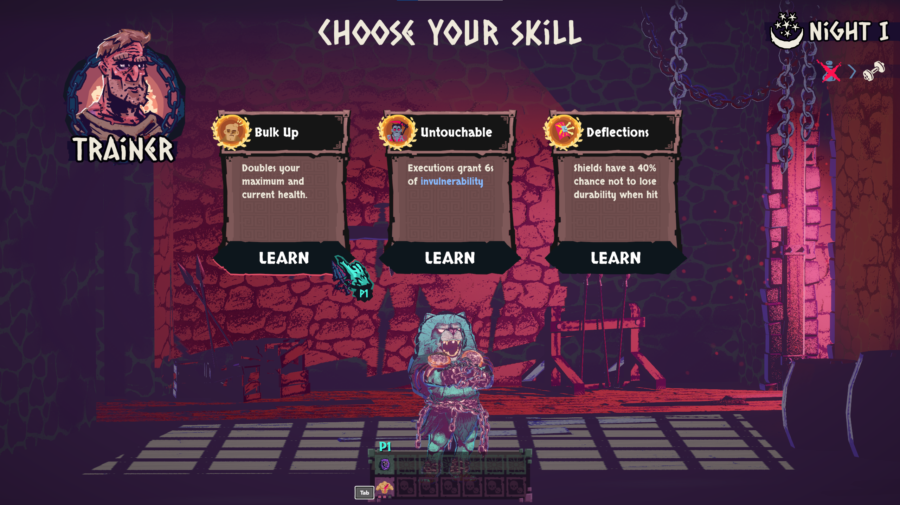
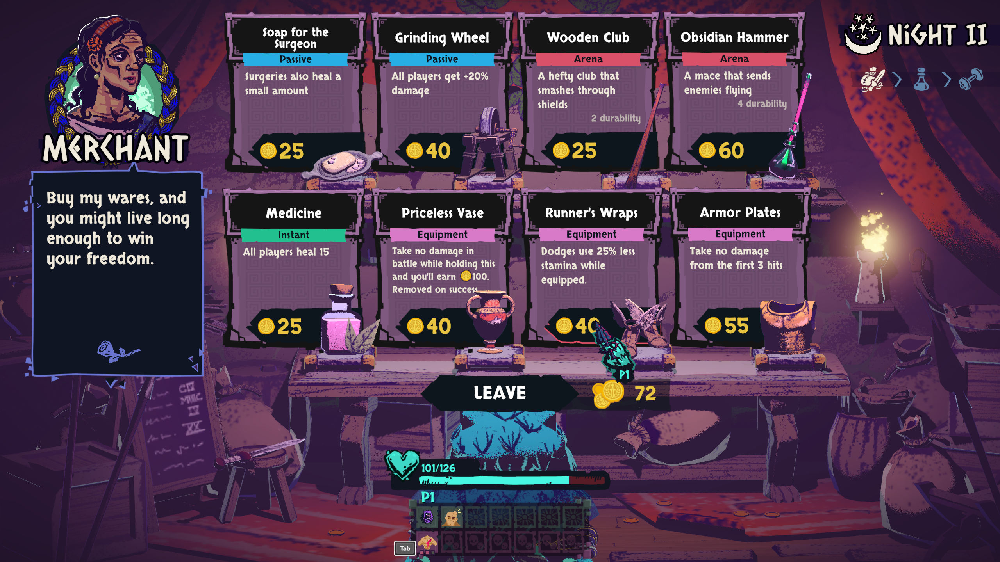
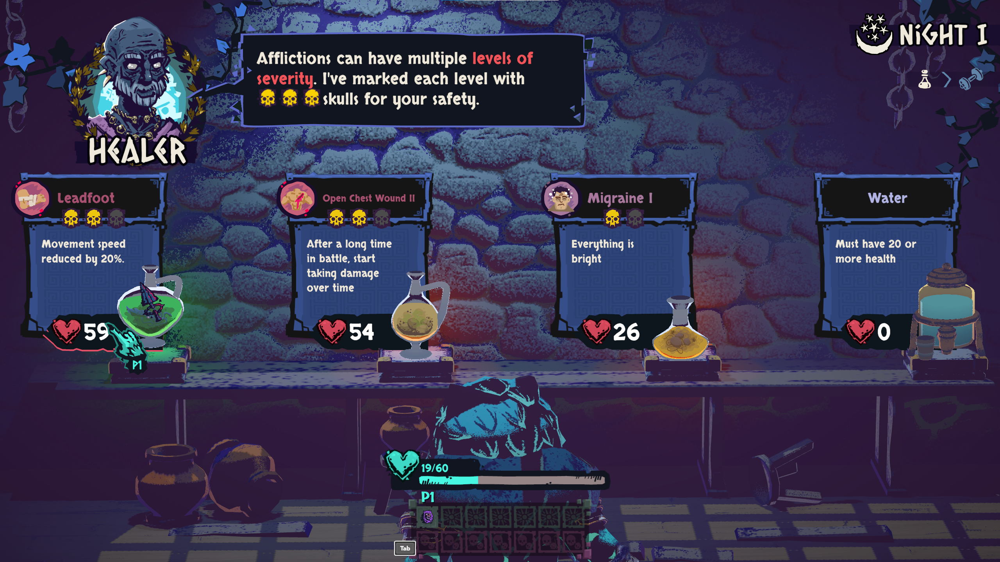
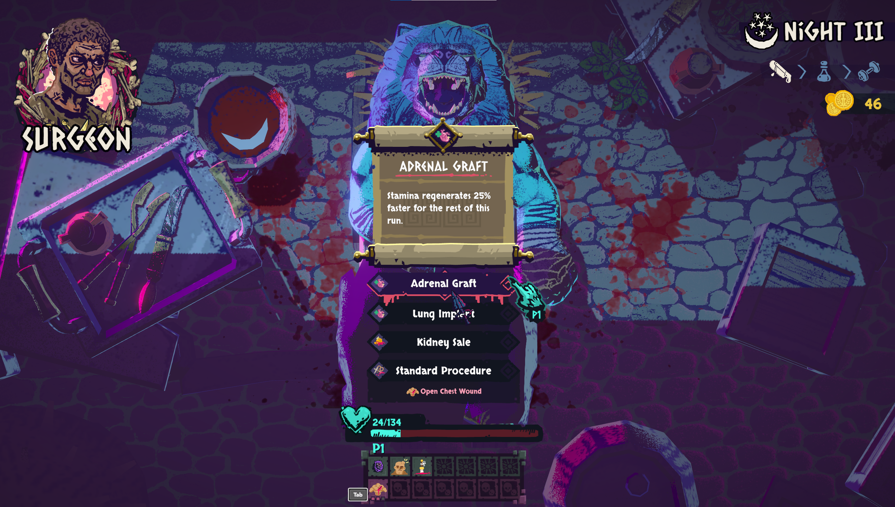
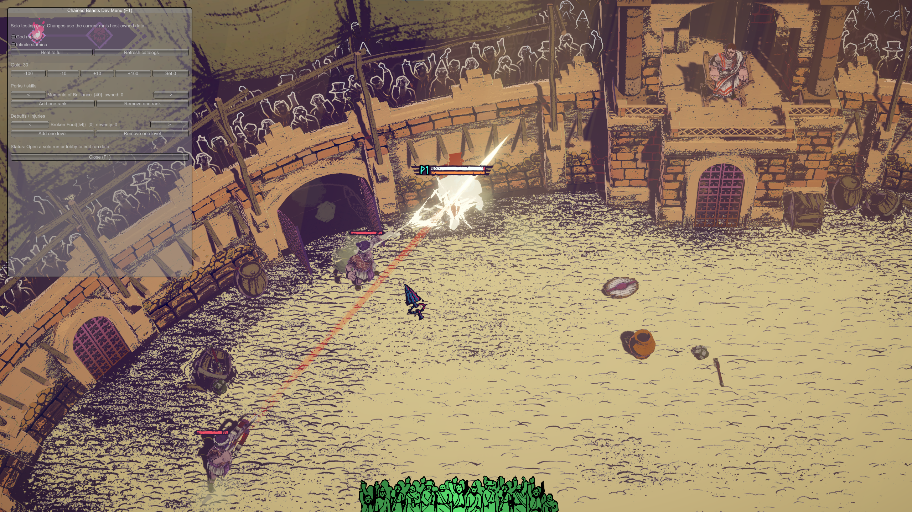

# Chained Beasts Mod Foundation + Terms & Contusions

**Terms & Contusions** is my experimental content pack for Chained Beasts: 46 skills, equipment items, potion afflictions and surgeries. **Mod Foundation** is the shared code behind it, which other modders can use to make their own additions.

The [**0.9.3 experimental prerelease**](https://github.com/Krrrrrrk/chained-beasts-mod-foundation/releases/tag/v0.9.3) targets **Chained Beasts 1.0.2**, Steam build **26231777**. [**Battle Numbers 0.2.2**](https://github.com/Krrrrrrk/Chained-Beasts_Battle-Numbers/releases/tag/v0.2.2) is the optional companion. See [compatibility notes](docs/GAME_UPDATE_1.0.2.md).

| What do you want to do? | Start here |
|---|---|
| **Play with the content I made** | [Quick install](#quick-install) — download the ready-made mod |
| **Build the project or make your own mod** | [Developer starting point](#make-your-own-mod) — source, examples and tutorials |

**I made zero attempt to balance these experimental additions.** They might be wildly overpowered, bad, or simply not work yet. My quick Solo check looks okay so far. Everything is still experimental and needs more testing, especially multiplayer.

<a id="install"></a>

## Quick install

These steps are for the **Steam version of Chained Beasts on 64-bit Windows**. The current experimental release is **0.9.3**, built for game version **1.0.2**, Steam build **26231777**. You do not need Git, PowerShell or a .NET SDK to install the downloads.

**Already using an older version of this mod?** Follow [updating an existing install](docs/INSTALLATION.md#updating-an-existing-install) first.

### 1. Find your game folder and back up your saves

In Steam, right-click **Chained Beasts → Manage → Browse local files**. This opens the folder containing `ChainedBeasts.exe`. Keep that folder open and **close the game**.

Before installing, [back up your saves](docs/INSTALLATION.md#back-up-your-install-and-saves). The guide gives the exact folder to copy.

### 2. Install BepInEx once

BepInEx is the loader that lets the game run mods. **If you already have the working BepInEx 6 IL2CPP x64 setup, skip to step 3.**

1. [**Download the tested BepInEx loader**](https://builds.bepinex.dev/projects/bepinex_be/791/BepInEx-Unity.IL2CPP-win-x64-6.0.0-be.791%2Bb782da4.zip): **6.0.0-be.791+b782da4, Unity IL2CPP, Windows x64**.
2. Open the ZIP and extract **all of its contents into the game folder**, beside `ChainedBeasts.exe`. The `BepInEx` folder belongs directly there, without an extra download-name folder around it.
3. Launch the game normally. The first launch can take longer while BepInEx prepares its files. Wait for the main menu, then **close the game again**.

Use the linked IL2CPP x64 build; the Mono and x86 downloads are for other game setups. [More loader help](docs/INSTALLATION.md#troubleshooting).

### 3. Install Terms & Contusions

[**Download Terms & Contusions 0.9.3 + Foundation — the recommended mod ZIP**](https://github.com/Krrrrrrk/chained-beasts-mod-foundation/releases/download/v0.9.3/TermsAndContusions-with-Foundation-0.9.3.zip)

Open that ZIP and copy its **`BepInEx` folder into the same game folder** from step 1, merging it with the existing `BepInEx` folder.

Both files should now be present:

- `Chained Beasts\BepInEx\plugins\ChainedBeasts.ModFoundation.dll`
- `Chained Beasts\BepInEx\plugins\TermsAndContusions.dll`

**The recommended ZIP includes both mod DLLs. BepInEx itself is the separate download in step 2.** Use the named mod ZIP above; GitHub's automatic **Source code** downloads are for building the project.

### 4. Launch the game and play Solo

Start the game normally and play **Solo**. The additions appear through the normal trainers, equipment shops, potions and surgeon options. Offers vary, so a custom entry is not guaranteed to appear immediately.

Custom descriptions begin with **`TC:`**, making them easy to spot. You do not need to open the F1 testing menu or enable forced offers to play.

**Need help?** See [troubleshooting](docs/INSTALLATION.md#troubleshooting), [settings](docs/INSTALLATION.md#configuration), or [removing the mod and rolling back](docs/INSTALLATION.md#uninstalling-and-rolling-back). [All release downloads](https://github.com/Krrrrrrk/chained-beasts-mod-foundation/releases/tag/v0.9.3) are available for people who need individual packages.

## Experimental multiplayer downloads

The [**0.9.3 prerelease**](https://github.com/Krrrrrrk/chained-beasts-mod-foundation/releases/tag/v0.9.3) includes multiplayer support, mechanics fixes and activation cues for game **1.0.2**. Broader gameplay and host/client testing are still needed.

- [Foundation + Terms & Contusions 0.9.3](https://github.com/Krrrrrrk/chained-beasts-mod-foundation/releases/download/v0.9.3/TermsAndContusions-with-Foundation-0.9.3.zip)
- [All three multiplayer test mods, including Battle Numbers 0.2.2](https://github.com/Krrrrrrk/chained-beasts-mod-foundation/releases/download/v0.9.3/Chained-Beasts-Multiplayer-Test-0.9.3.zip)

Use the [multiplayer setup guide](docs/MULTIPLAYER.md): everyone needs matching gameplay DLLs/settings and must join before starting or resuming. Back up your complete save/config/plugin set before switching versions.

## What's included

| Content | Number | How it works |
|---|---:|---|
| Skills | 12 | Four ranks per custom skill |
| Equipment | 12 | Bonuses while equipped |
| Potion afflictions | 11 | Three severity levels |
| Surgeries | 11 | Once per player per run |

Read the [complete content catalog](docs/terms-and-contusions/CATALOG.md) for names, effects, prices and scaling, or the [content-pack guide](docs/terms-and-contusions/README.md) for more detail.

## Screenshots

These are from the earlier four-example build. They show the cards and optional F1 tools; they do not show the entire current catalog.

<details>
<summary>Show screenshots</summary>

| Bulk Up | Runner's Wraps |
|---|---|
|  |  |

| Leadfoot | Adrenal Graft |
|---|---|
|  |  |



</details>

## Configuration and F1 tools

After launching with the mod installed, its settings are in:

- **Content pack:** `BepInEx/config/local.chainedbeasts.termsandcontusions.cfg`
- **Foundation and F1 tools:** `BepInEx/config/local.chainedbeasts.modfoundation.cfg`

Close the game before editing these files, then restart. Normal offers are enabled by default. Keep owned content enabled while continuing a saved run; see [configuration and save guidance](docs/INSTALLATION.md#configuration).

**F1 opens an optional testing menu** with healing, gold, skill/injury controls, offer rerolls and temporary cheats. Use a disposable run when experimenting with those controls. Surgery rerolls are still unreliable.

In **0.9.3**, custom procs also have an optional local dust
puff and swish when their benefit is confirmed. Butcher's Apron cues actual HP
restored, including the normal healing cap. See [activation feedback, settings
and the mechanics review](docs/ACTIVATION_FEEDBACK.md). I still need to test more effects and interactions.

<a id="build-and-make-your-own-mod"></a>

## Make your own mod

Foundation provides shared content registration, localization, stat/combat events, lifecycle handling and custom checkpoint state. **Terms & Contusions is a separate plugin built on it.** You can use Foundation without installing my content pack.

Start with the [developer setup and build guide](docs/foundation/README.md). It covers Git, PowerShell 7, the .NET SDK, installed game references, a fresh checkout and build commands.

Then follow the [separate-mod walkthrough](docs/foundation/SEPARATE_MOD.md) and the [buildable standalone example](examples/StandaloneContentExample/README.md). Each content category also has a tutorial:

| Make a… | Tutorial |
|---|---|
| Skill | [Custom skill](docs/foundation/tutorials/SKILL.md) |
| Equipment item | [Custom equipment](docs/foundation/tutorials/EQUIPMENT.md) |
| Potion affliction | [Custom affliction](docs/foundation/tutorials/AFFLICTION.md) |
| Surgery | [Custom surgery](docs/foundation/tutorials/SURGERY.md) |

For deeper work, see [architecture](docs/foundation/ARCHITECTURE.md), [mechanics and events](docs/foundation/MECHANICS.md), [save handling](docs/foundation/PERSISTENCE.md), [native hook safety](docs/foundation/MECHANICS.md#native-hook-safety), and the [content manifest](docs/terms-and-contusions/manifest.json).

## Testing and limitations

The current build targets **Chained Beasts 1.0.2**, Steam build **26231777**, **Unity 6000.3.21f1**, Windows x64, and the BepInEx build linked above.

My quick Solo check looks okay so far. I haven't verified every rank, interaction or save/resume case, and multiplayer still needs a manual host/client test. See the [0.9.3 release notes](https://github.com/Krrrrrrk/chained-beasts-mod-foundation/releases/tag/v0.9.3).

- [Experimental multiplayer](docs/MULTIPLAYER.md) requires matching gameplay mods and settings on every PC, with everyone joining before starting/resuming. Late joining, reconnecting and host migration are not supported.
- Icons and models reuse the game's existing visuals.
- New text uses English fallback; supplied translations have not had native-speaker review.
- Custom save data is not automatically synchronized through Steam Cloud. Back up the complete save folder and matching mods/configs together.
- Full arena-instance and current-stamina restoration are not supported.

## Bug reports

If you submit a bug report, **please include your `Player.log`** so I can investigate what happened. You can find it here:

```text
%USERPROFILE%\AppData\LocalLow\Featherweight Games\ChainedBeasts\Player.log
```

If available, also attach `Player-prev.log` from the same folder and `BepInEx\LogOutput.log` from your game folder. Include your mod version and what you were doing when the issue occurred. Copy the logs before launching the game again so the relevant session isn't overwritten.

## License

My original project code and documentation are under [MIT](LICENSE). BepInEx, HarmonyX, Unity, IL2CPP bindings and the game keep their own licenses; see [third-party notices](THIRD_PARTY_NOTICES.md).

This is an unofficial project, unaffiliated with Featherweight Games.
