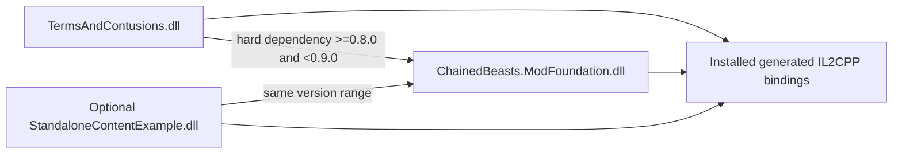

# Foundation and pack ownership (through Stage 6)

## Dependency direction

Foundation has no pack/example dependency. All plugins retain `net6.0`, tested loader references, unique GUIDs and assemblies. The example is outside the production catalog and deployment.

## Ownership

| Foundation | Terms & Contusions |
|---|---|
| Shared registration, numeric/key/native collision checks | Four existing numeric IDs and stable pack keys |
| Library callback scheduling and native catalog enumeration | Actual SkillDef/PurchaseDef/InjuryDef factories and eligibility |
| Owned-text API for independent plugins | Preserved twelve-language table and numeric/legacy aliases |
| One stat/modifier dispatch point per existing stat | Bulk Up, Runner's Wraps, Leadfoot and Adrenal Graft factor rules |
| Canonical ownership, run/battle/equipment events | Bulk Up proportional current-HP transition subscriber |
| Versioned checkpoint capture/matching/write/restore | Two declarative, example-specific legacy import rules |
| Generic developer tools with actual Solo authority | Four startup enable choices and Solo-only forced offers |
| Exact-signature patch helpers and config import helper | Native surgery generator/completion compatibility implementation |

Stage 1 moved the original feature classes once, preserving their GUID-independent IDs/text. Stage 2 removes their private skill/affliction checkpoint bridges and stat getter patches; the shared core now owns those boundaries. It also removes Bulk Up's permanent processed-level cache and developer-menu-only resynchronization. The old menu event remains API compatibility only, with no Bulk Up subscriber.

## Startup, collisions and cleanup

BepInEx's hard dependency orders Foundation first. Foundation installs its checkpoint, ownership, stat and text adapters as one Harmony owner and sets `IsReady` only after success. Failure unpatches that owner's partial hooks. The pack/example refuse to initialize without it.

The pack binds its startup booleans, intentionally imports existing config choices once, and atomically claims all four identities even when disabled. A later batch collision leaves none of its earlier claims installed. Enabled factories run around native GameLibrary.Init; shared GetAllSkill/Purchase/InjuryTypes hooks expose registered content without duplicate IDs. Surgeries explicitly use their generator rather than pretending a registry exists.

Duplicate keys, category IDs, native IDs and legacy-slot claims fail. A factory verifies foreign definitions before adding its own; verification/localization failures disable that identity and contributions. Per-feature installation failures unpatch that feature and disable its identity. Disabled identities do not retain active pack lookup aliases or stat rules. No automatic renumbering can invalidate an old save silently.

The optional standalone plugin demonstrates real public API use and its own failure cleanup. Its per-skill rank/order is stored by Foundation, without a copied marker. Shared source registries cannot police arbitrary foreign mods that bypass the API or mutate definitions after initialization; that compatibility remains outside the guarantee.

## Ownership, stats and presentation

Canonical Add/RemoveSkill and Add/RemoveInjury hooks snapshot the before rank and publish only a successful changed rank. Signed native counts are bounded; nested calls and duplicate finalization do not emit another event. Pointer-based keys exist only inside the synchronous mutation guard, never saved. Checkpoint restore assigns dictionaries rather than invoking acquisition.

Bulk Up now uses factors 2x/3x/4x/5x at ranks 1–4. Both gain and loss scale current HP by new max / old max with attainable-health/death clamps; an ordinary removal followed by reacquisition has a new real before/after transition. The developer menu avoids repeating its generic HP adjustment for registered custom skills. The four-rank formula is tested through the same production logic; native HUD behavior remains manual.

The shared pipeline recomputes contributions from the otherwise-normal getter value. No cached maximum is multiplied on refresh, and reads never heal. Leadfoot reads native effective severity, respecting suppression/reduction; equipment predicates reflect actual current equipment; surgery history remains native authoritative.

The confirmed v0.7.3 banner fix remains intact: forced Bulk Up updates both the stored training row and the temporary return list. Acquisition and later reveal see the same ID even after ownership stops forcing new offers. No native banner detours, arbitrary UI scans or global string replacement were added.

## Persistence and supported scope

See [the exact protocol](PERSISTENCE.md) and [native evidence](STAGE2_EVIDENCE.md). New per-content ownership is external, associated with one shared native discriminator and canonical full-checkpoint fingerprint. A sidecar is published only after successful native SaveData task completion, with exact-file proof for crash-window recovery. Native equipment/surgery histories are never overwritten by duplicate sidecar ownership.

Run reset/clear/new identity clears live state. Immutable archives remain for paired older-save backups. Unknown data is preserved; actual restoration refuses missing/incompatible/disabled owned content rather than resuming an incomplete build. The adapter currently supports Solo on the inspected Windows Steam/default SKU; multiplayer persistence is not implemented.

Developer actions and forced offers require real Solo mode, one local client, one player, and host authority. God mode/stamina overrides clear on reset or leaving that state. The minimal battle key covers the current level scope, not all future enemy/weapon lifecycle semantics.

Stage 6 replaces Adrenal Graft's old money-only heuristic with native completion receipts, normal return/payment confirmation and authoritative native surgery history. Surgery rerolls remain deferred. Stage 3 adds scoped committed attacks, actual HP-loss receipts, direct-hit reservations, normal durability-break events and normal throw/preview/charge integration. Feature-state schema validation runs before restore, and capture failures preserve the prior native save. See [Stage 3 evidence](STAGE3_EVIDENCE.md). Stage 4 adds execution/backstab/recovery evidence, physical representation identity, queued durability costs and flat-aware damage composition; equipment formulas/allowances remain in the pack. See [Stage 4 evidence](STAGE4_EVIDENCE.md). Stage 5 adds actual stamina/payment, regeneration, shield, dodge and crowd contribution events plus target/action context; affliction values, severity and timers/counters remain in the pack. See [Stage 5 evidence](STAGE5_EVIDENCE.md). Stage 6 extends only concrete surgery concerns. No intermediate DLL is deployed, and no new runtime correctness is claimed.

Stage 6 adds shared native surgeon offers/completion and fresh maximum-stamina, dodge-distance, knockback and healing dispatch in Foundation. The pack owns the eleven definitions, prices, tradeoffs and remaining-time ledgers. Native surgery history remains authoritative. See [Stage 6 native evidence](STAGE6_EVIDENCE.md).
